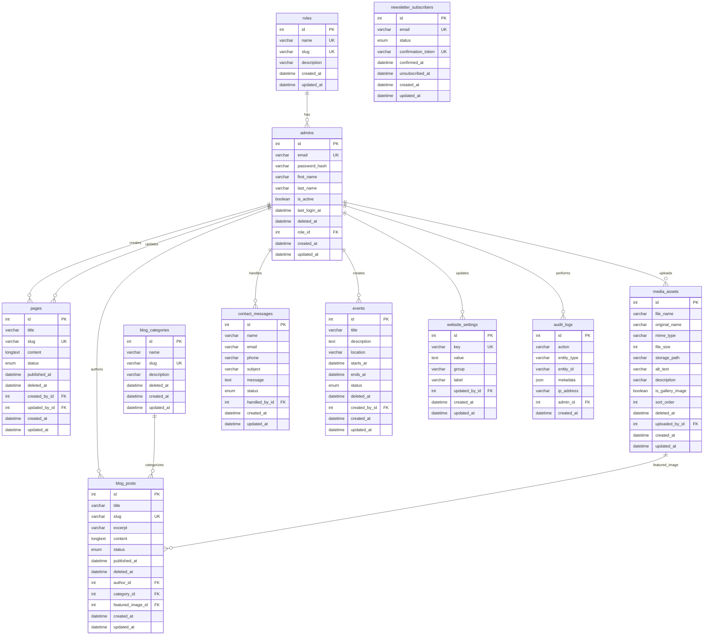

# Database ERD — High School Website Platform

Mermaid entity-relationship diagram of the Phase 3 core schema. Soft-delete columns and minor metadata fields are omitted for readability where they do not affect relationships.

## Relationship notes

| From | To | On delete |
|------|----|-----------|
| `admins.role_id` | `roles` | Restrict |
| `blog_posts.author_id` | `admins` | Restrict |
| `blog_posts.category_id` | `blog_categories` | SetNull |
| `blog_posts.featured_image_id` | `media_assets` | SetNull |
| Most optional `*_by_id` / `admin_id` FKs | `admins` | SetNull |
